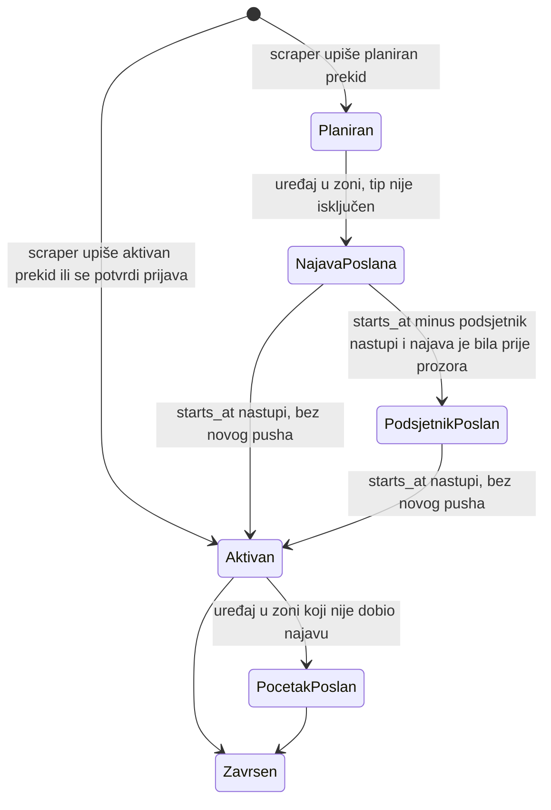
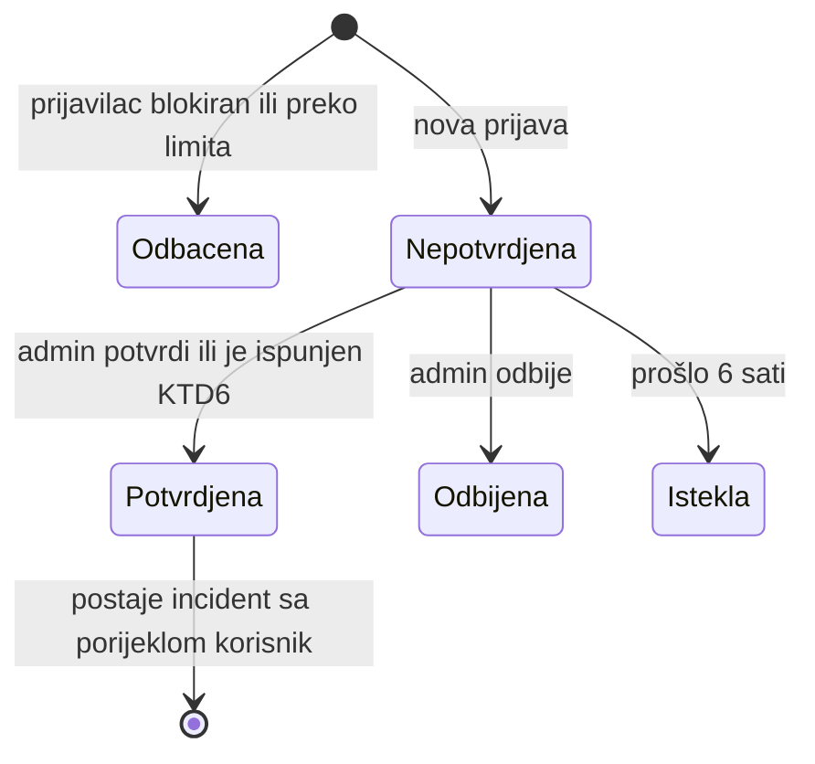
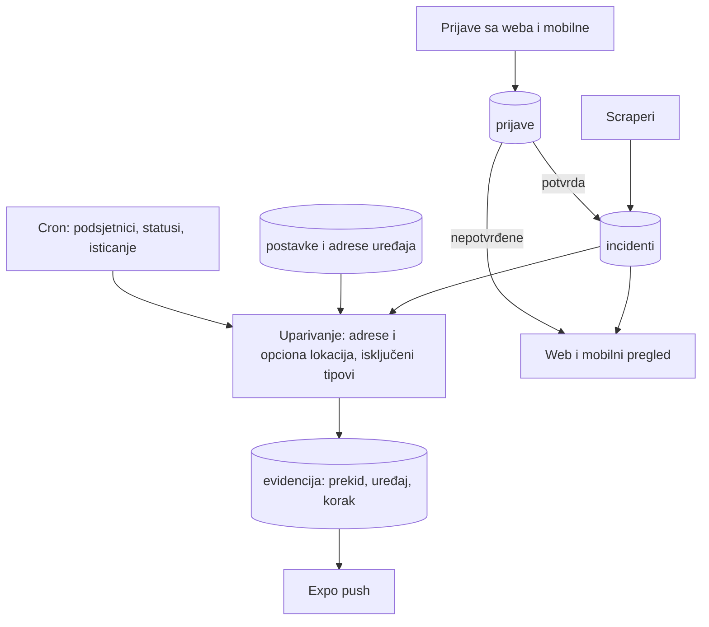
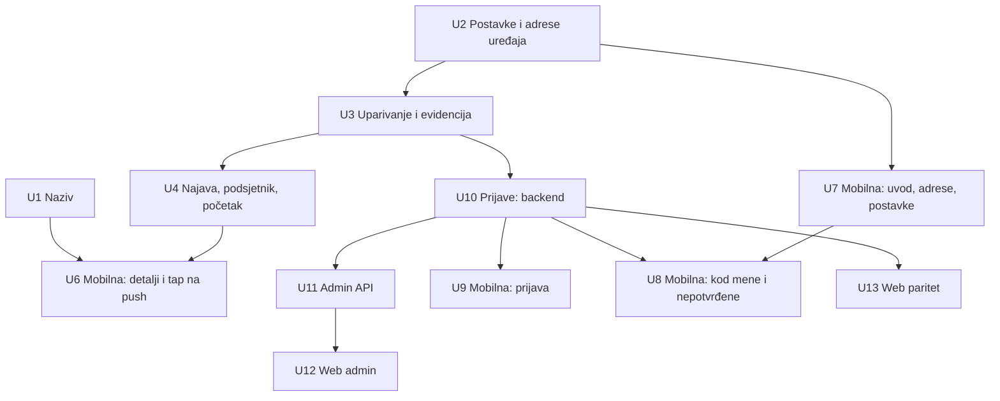

# ServisneInfo v1 oblik proizvoda - Plan

## Goal Capsule

- **Cilj:** Stanovnik Kantona Sarajevo sazna za prekid vode, struje, gasa, grijanja ili interneta na svojoj adresi prije nego što počne, bez da ga traži, i može vidjeti sve aktuelne prekide na webu ili u mobilnoj aplikaciji.
- **Sredstvo:** Postojeći scraperi i incidenti ostaju izvor istine. Dodaju se postavke po uređaju (adrese, lokacija, tipovi, podsjetnik), obavijesti po koraku (najava, podsjetnik, početak) i prijave korisnika koje nakon potvrde postaju incidenti (KTD1, KTD3, KTD5).
- **Autoritet:** Product Contract (Faruk, 2026-10-29) ima prednost za ponašanje, a Planning Contract za mehanizam. Abdullah Husrep je vlasnik repoa i odobrava PR-ove.
- **Profil izvršenja:** Fazno, A do E. Svaka jedinica je zaseban tiket i zaseban PR na branchu iz `main`.
- **Uslovi za zaustavljanje:** Stani i pitaj ako jedinica traži promjenu ponašanja iz Product Contracta, ako migracija ne može ostati idempotentna, ili ako se pokaže da je bundle ID već registrovan u storeu.
- **Ko završava:** Jedinice preuzimaju članovi tima kojima Faruk dodijeli tikete. Merge odobrava Abdullah.
- **Otvorene blokade:** PR #9 (test skripta i CI) mora biti mergovan prije Faze A. Objava u store zavisi od #36, #31, #30 i od Abdullahove infrastrukture (#2–#8).

---

## Product Contract

Product Contract preservation: changed: R10, R16, AE7 — usklađeno sa AE2 i KTD6 (oboje već dogovoreno), bez promjene opsega. Pitanja koja su bila "Deferred to Planning" riješena su u KTD6, KTD8, KTD10 i KTD12, pa je ta sekcija uklonjena.

### Summary

ServisneInfo v1 je jedno mjesto za službene obavijesti o prekidima komunalnih usluga i za potvrđene prijave korisnika u Kantonu Sarajevo.
Web i mobilna aplikacija nude isti pregled. Mobilna aplikacija jedina šalje push obavijesti, za sačuvane adrese i opciono za trenutnu lokaciju, uz najavu i podsjetnik za planirane prekide.
Korisničke prijave se odmah vide kao nepotvrđene, a push okidaju tek kad ih potvrdi admin ili više uređaja.

### Problem Frame

Danas ljudi u Sarajevu za nestanak vode ili struje saznaju na tri načina: iz Facebook grupa, otvaranjem stranica ViK-a ili Elektrodistribucije, ili tek kad otvore česmu.
Informacija o planiranim prekidima postoji dan ili dva unaprijed, ali je raštrkana na pet stranica i niko je ne dostavlja čovjeku na čiju adresu se odnosi.
Postojeći kod već skuplja obavijesti i šalje push po zadnjoj GPS lokaciji telefona. Međutim, ne zna za adrese koje korisnika zanimaju, ne razlikuje najavu od početka prekida, a prijave korisnika završe u bazi koju niko ne gleda.
Za ovu potrebu nemamo konkretnog korisnika koji je već nešto platio ili zaobilazno riješio. Vrijednost je pretpostavka koju v1 treba potvrditi.

### Actors

- A1. Korisnik mobilne aplikacije: stanovnik koji želi obavijest za svoje adrese ili lokaciju.
- A2. Posjetilac weba: gleda aktuelne prekide i šalje prijave, a obavijesti ne dobija.
- A3. Admin: moderira prijave i blokira uređaje koji spamaju. U v1 je to tim projekta.
- A4. Izvori: KJKP Vodovod, Elektrodistribucija EPBiH, Sarajevogas, Toplane Sarajevo i BH Telecom, čije se obavijesti automatski preuzimaju.

### Key Decisions

- **Web i mobilna su ravnopravni u pregledu, a obavijesti postoje samo na mobilnoj.** Web nema push ni email. (session-settled: user-directed — izabrano umjesto web pusha i emaila: obavijesti ostaju u aplikaciji, web je pregled.) Governs R1, R2, R8.
- **Okidač obavijesti su sačuvane adrese plus opciona trenutna lokacija.** (session-settled: user-directed — izabrano umjesto samo adresa i samo lokacije: adrese rade svima, a lokacija ostaje kao dodatak na mobilnoj.) Governs R5, R6, R7.
- **Nema korisničkih računa.** Adrese i postavke su vezane za uređaj i gube se pri promjeni telefona. (session-settled: user-approved — izabrano umjesto računa: manje posla i manje ličnih podataka za v1.) Governs R5.
- **Obavijesti po trenutnoj lokaciji su isključene dok ih korisnik ne uključi.** (session-settled: user-approved — izabrano umjesto lokacije uključene po defaultu: privatnost i review u storeu.) Governs R7.
- **Planirani prekid daje najavu pri objavi i podsjetnik prije početka.** (session-settled: user-approved — izabrano umjesto samo najave i samo obavijesti pri početku: korisnik se stigne pripremiti.) Governs R9, R10.
- **Prijave i moderacija ulaze u v1.** (session-settled: user-directed — izabrano umjesto prijedloga da se prijave odgode za drugu fazu.) Governs R14–R21.
- **Prijava je odmah vidljiva kao nepotvrđena, a push okida tek nakon potvrde.** Potvrđuje je admin ili više različitih uređaja. Zaštitu od spama čine limit, tiha blokada i isticanje. (session-settled: user-approved — izabrano umjesto moderacije prije objave, potvrde samo od admina i prijava bez pusha: radi i noću, a spamer ne može slati push.) Governs R15–R19, R21.
- **Admin ekran je dio weba, iza admin prijave.** (session-settled: user-approved — izabrano umjesto posebne admin aplikacije.) Governs R20.
- **Naziv je ServisneInfo svugdje.** (session-settled: user-directed — izabrano umjesto "Komunalni Info": isti naziv kao repo i web, a izraz "servisne informacije" koriste i preduzeća.) Governs R22.
- **Geografski opseg je Kanton Sarajevo, ali bez zaključavanja na jedan grad.** (session-settled: user-approved — izabrano umjesto više gradova odmah i samo Sarajeva zauvijek.) Governs R23.

### Requirements

**Pregled (web i mobilna)**

- R1. Web i mobilna prikazuju iste stvari: listu i mapu aktivnih i planiranih prekida, detalje prekida i ekran za prijavu.
- R2. Mobilna aplikacija ima ekran sa detaljima prekida. Tap na push obavijest otvara detalje tog prekida.
- R3. Korisnik može filtrirati prikaz po tipu usluge: voda, struja, gas, grijanje i internet.
- R4. Na webu i na mobilnoj korisnik može suziti prikaz na svoje sačuvane adrese ("kod mene").

**Adrese i lokacija**

- R5. Korisnik može sačuvati više adresa na uređaju (npr. kuća, posao, roditelji), bez korisničkog računa.
- R6. Sačuvana adresa se pri unosu provjerava i prikazuje na mapi, tako da korisnik vidi da je sistem prepoznao pravo mjesto.
- R7. Na mobilnoj korisnik može uključiti obavijesti po trenutnoj lokaciji. Ova opcija je isključena po defaultu.

**Obavijesti (samo mobilna)**

- R8. Push obavijest dobija uređaj čija sačuvana adresa ili, ako je uključena, trenutna lokacija upada u zonu prekida.
- R9. Za planirani prekid korisnik dobija najavu kad se prekid objavi.
- R10. Prije početka planiranog prekida korisnik dobija podsjetnik. Vrijeme podsjetnika može promijeniti ili ga isključiti, a po defaultu je 1 sat prije početka. Podsjetnik se ne šalje ako je najava stigla tek unutar tog prozora (AE2).
- R11. Za prekid koji se pojavi kao već aktivan korisnik dobija jednu obavijest kad se pojavi.
- R12. Uređaj dobija najviše jednu obavijest istog koraka po prekidu (najava, podsjetnik ili početak), i kad se zoni poklapa više adresa i lokacija.
- R13. Korisnik može isključiti obavijesti za tipove usluga koji ga ne zanimaju.

**Prijave korisnika**

- R14. Prijavu mogu poslati sa weba i sa mobilne. Sadrži tip, lokaciju ili adresu i kratak opis. Ime i kontakt su opcioni i vidi ih samo admin.
- R15. Prijava se odmah prikazuje u listi i na mapi, jasno označena kao nepotvrđena. Nepotvrđena prijava ne okida push.
- R16. Prijava postaje potvrđena kad je potvrdi admin ili kad 3 ili više različitih uređaja, sa različitih IP adresa, u kratkom roku prijave isti tip problema u blizini (pragovi u KTD6).
- R17. Potvrđena prijava se prikazuje i šalje obavijesti kao prekid koji je već aktivan (R11), uz oznaku da potiče od korisnika.
- R18. Uređaj može poslati ograničen broj prijava u vremenskom periodu.
- R19. Nepotvrđena prijava automatski nestaje nakon nekoliko sati ako je niko ne potvrdi.

**Moderacija**

- R20. Admin na webu, iza admin prijave, vidi prijave i može svaku potvrditi ili odbiti. Odbijena prijava nestaje iz javnog prikaza.
- R21. Admin može blokirati uređaj. Njegove prijave nestaju iz javnog prikaza, a nove se tiho odbacuju, bez poruke pošiljaocu.

**Brend i opseg**

- R22. Proizvod se zove ServisneInfo u storeu, u aplikaciji, na webu i u identifikatoru aplikacije.
- R23. v1 pokriva Kanton Sarajevo. Kasnije dodavanje drugog grada ne smije zahtijevati promjenu toga kako korisnik koristi proizvod.

### Key Flows

- F1. Prvo pokretanje mobilne aplikacije
  - **Trigger:** Korisnik instalira i otvori aplikaciju.
  - **Actors:** A1
  - **Steps:** Aplikacija traži dozvolu za push, a korisnik dodaje bar jednu adresu i vidi je na mapi. Zatim mu se nudi opcija obavijesti po trenutnoj lokaciji, a korisnik po želji isključuje tipove koji ga ne zanimaju.
  - **Outcome:** Uređaj je spreman da dobija obavijesti za svoje adrese.
  - **Covered by:** R5, R6, R7, R13
- F2. Planirani prekid od objave do početka
  - **Trigger:** Preduzeće objavi planirani prekid, a sistem ga preuzme.
  - **Actors:** A4, A1, A2
  - **Steps:** Prekid se pojavi na webu i mobilnoj kao planiran. Uređaji sa adresom ili lokacijom u zoni dobiju najavu, a u vrijeme podsjetnika dobiju podsjetnik. Kad prekid počne, prikazuje se kao aktivan.
  - **Outcome:** Korisnik se pripremio prije prekida.
  - **Covered by:** R1, R8, R9, R10, R12
- F3. Korisnička prijava do potvrde
  - **Trigger:** Korisnik prijavi kvar sa weba ili mobilne.
  - **Actors:** A1, A2, A3
  - **Steps:** Prijava se odmah prikaže kao nepotvrđena. Postane potvrđena kad je potvrdi admin ili kad stigne dovoljno prijava sa različitih uređaja. Tada uređaji u zoni dobiju obavijest. Ako je niko ne potvrdi, prijava istekne.
  - **Outcome:** Stvarni kvar stigne do ljudi u zoni, a lažni ne izazove push.
  - **Covered by:** R14, R15, R16, R17, R19
- F4. Moderacija i spam
  - **Trigger:** Admin otvori admin ekran ili primijeti spam.
  - **Actors:** A3
  - **Steps:** Admin pregleda prijave i potvrdi ili odbije svaku. Uređaj koji spama blokira, nakon čega njegove prijave nestanu.
  - **Outcome:** Javni prikaz ostaje vjerodostojan.
  - **Covered by:** R18, R20, R21

### Acceptance Examples

- AE1. **Covers R9, R10.** **Given** korisnik ima sačuvanu adresu u zoni i podsjetnik je na 1 sat, **when** ViK u ponedjeljak objavi prekid za utorak od 08:00, **then** korisnik odmah dobija najavu, a u utorak u 07:00 podsjetnik.
- AE2. **Covers R10, R12.** **Given** planirani prekid je objavljen 20 minuta prije početka, **when** sistem ga preuzme, **then** korisnik dobija samo najavu, bez posebnog podsjetnika.
- AE3. **Covers R12.** **Given** korisnik ima sačuvane adrese "kuća" i "posao" i obje su u zoni istog prekida, **when** se prekid objavi, **then** korisnik dobija jednu najavu, a ne dvije.
- AE4. **Covers R7, R8.** **Given** korisnik nije uključio obavijesti po lokaciji, **when** se nađe u zoni prekida koja ne pokriva nijednu njegovu adresu, **then** ne dobija obavijest.
- AE5. **Covers R13.** **Given** korisnik je isključio grijanje, **when** se objavi obustava grijanja na njegovoj adresi, **then** ne dobija push, ali prekid i dalje vidi u listi.
- AE6. **Covers R15, R16.** **Given** jedan uređaj pošalje tri prijave za isti kvar, **when** niko drugi ne prijavi, **then** prijava ostaje nepotvrđena i ne šalje push.
- AE7. **Covers R16, R17.** **Given** tri različita uređaja sa različitih IP adresa u kratkom roku prijave nestanak vode u istoj ulici, **when** stigne treća prijava, **then** prijava postaje potvrđena i uređaji u zoni dobijaju obavijest.
- AE8. **Covers R19.** **Given** nepotvrđena prijava koju niko nije potvrdio, **when** prođe period isticanja, **then** prijava nestaje iz liste i sa mape.
- AE9. **Covers R21.** **Given** admin je blokirao uređaj, **when** taj uređaj pošalje novu prijavu, **then** pošiljalac vidi uobičajenu potvrdu slanja, ali se prijava nigdje ne prikazuje.

### Success Criteria

- Glavni znak uspjeha je broj korisnika mobilne aplikacije. Ciljna brojka još nije određena.
- Uslov za taj cilj su tačne zone i pravovremene obavijesti. Obavijest za pogrešnu ulicu ili zakašnjela obavijest tjeraju ljude da obrišu aplikaciju, pa se tačnost prati od prvog dana.

### Scope Boundaries

**Odgođeno za kasnije**

- Obavijesti na webu: web push i email.
- Korisnički računi i sinhronizacija adresa između uređaja.
- Gradovi izvan Kantona Sarajevo.
- Obavijest kad se prekid završi.
- Arhiva i statistika prekida (#35).
- Offline prikaz na mobilnoj (#32).

**Izvan identiteta proizvoda**

- Društvena mreža ili forum: prijave služe samo kao signal o kvaru, bez komentara i razgovora.
- Zamjena za službene kanale preduzeća: ServisneInfo ne prima reklamacije u ime preduzeća.

**Razmotreno i ne gradi se u v1**

- Pravi admin računi sa lozinkama: jedan tajni token je dovoljan za mali tim (KTD8). Mijenja se kad moderira više od par ljudi.
- Opšti rate limiting na svim javnim endpointima: ostaje u #13. Ovaj plan ograničava samo prijave (KTD10).

### Dependencies / Assumptions

- Pretpostavka je da ljudi žele obavijesti unaprijed i da će zbog toga instalirati aplikaciju. Nemamo korisnika koji je to već tražio.
- Pretpostavka je da preduzeća nastave objavljivati planirane prekide na svojim stranicama u obliku koji se može automatski čitati.
- Objava u store zavisi od politike privatnosti (#36), EAS builda (#31) i nadogradnje Expo SDK-a (#30).
- Pokretanje na produkciji zavisi od Abdullahove infrastrukture (#2–#8).

### Sources / Research

- Push danas: `apps/backend/src/services/notifications.ts` gađa uređaje po zadnjoj GPS lokaciji. `apps/backend/src/services/geofencing.ts` šalje obavijest i kad nova lokacija upadne u aktivan prekid. Planirani prekid dobija push već pri prvom upisu (`apps/backend/src/scrapers/base.ts`), a `apps/backend/src/jobs/status.job.ts` ga prebacuje u aktivan bez pusha.
- Zona prekida je bafer od 150 m oko geokodiranih adresa (`apps/backend/src/scrapers/base.ts`).
- Prijave: `apps/backend/src/routes/reports.ts` (status `pending`, čita samo admin) i `apps/web/src/pages/Report.tsx` (forma sa imenom i kontaktom). Status prijave se nigdje ne mijenja.
- Naziv: `apps/mobile/app.json` koristi "Komunalni Info" i `ba.komunalniinfo.app`.
- Mobilna ima samo dva taba (`apps/mobile/app/(tabs)/`). Tap na karticu otvara izvor u browseru (`apps/mobile/components/IncidentCard.tsx`).
- Postojeći tiketi koji se preklapaju s ovim planom: #10 (obavijest kad planirani postane aktivan, zamjenjuje se sa R9–R11), #12 (moderacija, R20–R21), #13 (rate limiting, R18), #27 (detalji na mobilnoj i otvaranje iz notifikacije, R2), #28 (postavke obavijesti, R10, R13), #29 (prijava sa mobilne, R14), #37 (naziv, R22).

---

## Planning Contract

### Key Technical Decisions

- KTD1. **Uređaj se identifikuje `tokenId`-em (UUID) koji služi kao tajni ključ za njegove postavke i adrese, i ne zavisi od push tokena.** Nema računa (Governs R5 preko Key Decision "Nema korisničkih računa"). Mobilna se registruje pri prvom pokretanju i bez dozvole za push, a Expo token se kasnije veže na isti red i po potrebi mijenja. Danas `tokenId` nastaje tek uz dozvolu za push (`apps/mobile/services/notifications.ts`), pa bi korisnik bez pusha ostao i bez adresa (R4, R5) i bez prijave (R14). `tokenId` se šalje samo u headeru, nikad u URL-u, jer Fastify loguje URL-ove.
- KTD2. **Adrese mobilnog uređaja se čuvaju na serveru, a adrese na webu samo u browseru.** Server mora znati adrese da bi poslao push (R8). Web nema obavijesti, pa njegove adrese služe samo za filter (R4) i ne napuštaju browser.
- KTD3. **Evidencija poslanih obavijesti se vodi po trojci (prekid, uređaj, korak).** Koraci su najava, podsjetnik i početak. Tako se provodi R12 i spriječava duplikat kad se poklopi više adresa (AE3). Postojeći zapisi se pri migraciji vode kao najava.
- KTD4. **Podsjetnik šalje backend, cron provjerom svake minute, a ne lokalno zakazana notifikacija na telefonu.** Server pri svakom scrapeu vidi da li je planirani prekid još objavljen. Lokalna notifikacija bi ostala na starom terminu. Pomjeren termin stiže kao novi incident (ključ deduplikacije uključuje početak), pa novi termin dobija svoju najavu. Stari termin, koji izvor više ne objavljuje, se zatvara bez podsjetnika. Podsjetnik ide samo ako je najava poslana prije početka prozora za podsjetnik (AE2).
- KTD5. **Potvrđena prijava postaje red u tabeli incidenata sa oznakom porijekla "korisnik".** Tako koristi postojeći prikaz, obavijesti i statuse bez paralelnog sistema (R17). Zona je bafer od 150 m oko tačaka prijava, kao kod scrapera. Početak je vrijeme najranije prijave, a `last_seen_at` vrijeme zadnje prijave koja ga podržava. Prekid se sam zatvara 6 sati nakon te zadnje prijave i ne podliježe pravilu status joba za službene prekide bez kraja.
- KTD6. **Automatska potvrda traži 3 prijave istog tipa u krugu od 500 m u zadnja 2 sata, sa 3 različita uređaja i 3 različite IP adrese.** Uslov sa IP adresama sprečava da jedan spamer brisanjem kolačića na webu sam potvrdi prijavu. (session-settled: user-approved — izabrano umjesto brojanja samo uređaja: web ID je lako lažirati.) Governs R16.
- KTD7. **Web dobija anonimni ID prijavioca u localStorage, a IP adresa se čuva samo kao hash sa tajnom soli.** Bez ID-a ne bi radili limit, blokada ni brojanje uređaja (R18, R21). Sirova IP adresa se ne čuva, zbog privatnosti (#26, #36). IP klijenta se uzima preko Fastify `trustProxy`, podešenog na tačan broj proxy hopova produkcijskog hostinga (env varijabla). Bez toga bi server iza proxyja vidio jednu IP adresu za sve, pa KTD6 nikad ne bi potvrdio prijavu, a KTD10 bi dijelio jedan limit na cijeli grad. Neograničen `trustProxy` bi pak dao klijentu da sam lažira IP kroz `X-Forwarded-For`.
- KTD8. **Admin se na webu prijavljuje postojećim `ADMIN_TOKEN`-om, koji se čuva u sessionStorage i šalje kao Bearer.** Koristi se postojeći `requireAdmin` iz `apps/backend/src/auth.ts`. (session-settled: user-approved — izabrano umjesto pravih admin računa: v1 je mali tim.) Governs R20.
- KTD9. **Blokirani prijavilac dobija isti odgovor 201 kao i ostali, a prijava se odbacuje bez upisa u javni prikaz.** Ovo provodi R21 i AE9.
- KTD10. **Limiti: najviše 3 prijave na sat po prijaviocu, nepotvrđena prijava ističe nakon 6 sati, a uređaj može sačuvati najviše 5 adresa. Prijave sa weba imaju i limit od 3 na sat po IP hashu, a prijave sa mobilne samo limit po uređaju.** Kod mobilnih operatera mnogo korisnika dijeli jednu IP adresu, pa bi limit po IP-u odbacivao stvarne prijave baš kad nestane vode u cijelom kvartu. Lažiranje web ID-a i dalje pokriva uslov sa različitim IP adresama iz KTD6. (session-settled: user-approved — izabrano umjesto ostavljanja vrijednosti otvorenim i umjesto limita po IP-u i za mobilnu.) Governs R5, R18, R19.
- KTD11. **Lokacija je opt-in i na klijentu i na serveru.** Mobilna ne traži dozvolu za lokaciju niti je šalje dok korisnik ne uključi opciju. Server lokaciju gleda samo kad je opcija uključena, a pri isključivanju briše zadnju poznatu lokaciju (R7).
- KTD12. **Adresa se geokodira postojećim Nominatim pozivom ograničenim na Sarajevo, a korisnik potvrđuje ili pomjera pin prije čuvanja.** Za obavijesti se koristi potvrđena tačka (R6). Nepotvrđena prijava se na mapi prikazuje kao tačka, a ne kao zona.
- KTD13. **Identifikator aplikacije postaje `ba.servisneinfo.app`.** Ovo je sigurno samo zato što aplikacija još nije objavljena (R22). (session-settled: user-approved — izabrano umjesto zadržavanja `ba.komunalniinfo.app`.)

### High-Level Technical Design

Obavijesti po prekidu i uređaju (KTD3, KTD4). Dijagram vodi, ali R9–R12 su autoritet.

Uređaj "uđe u zonu" kad mu se doda adresa ili kad pošalje lokaciju (uz uključenu opciju). Tada dobija korak koji odgovara trenutnom statusu prekida: najavu za planiran, a početak za aktivan.

Životni ciklus prijave (KTD5, KTD6, KTD9, KTD10):

Tok podataka:

### Assumptions

- PR #9 je mergovan, pa postoje `npm test`, `npm run typecheck` i CI sa PostGIS bazom.
- Aplikacija nije u storeu niti ima EAS projekat pod starim bundle ID-om. U suprotnom važi uslov za zaustavljanje.
- Nominatim sa postojećim throttlingom (1 zahtjev u sekundi) je dovoljan za unos adresa u v1.

### Sequencing

Faza A (temelji) ide prva. Faza B ide poslije A. Faza D počinje nakon U3, jer U10 zavisi od U3, i može ići paralelno sa U4. Faza C zavisi od B, a dijelom i od D. Faza E zavisi od D.

### System-Wide Impact

- **Privatnost:** Server sada čuva adrese po uređaju i hash IP-a prijavioca. Politika privatnosti (#36) i brisanje podataka (#26) moraju to pokriti prije objave.
- **Migracije:** Tri nove migracije (004–006) mijenjaju tabele uređaja, obavijesti i prijava. Moraju biti idempotentne, kao 001–003.
- **Auth:** Novi endpointi za uređaj su zaštićeni samo `tokenId`-em (KTD1). Admin endpointi koriste `requireAdmin`.
- **Cron:** Postojeći status job dobija isticanje prijava i zatvaranje korisničkih prekida, a novi job svake minute šalje podsjetnike.

### Risks & Dependencies

| Rizik | Ublažavanje |
|---|---|
| Geokodiranje adrese promaši ulicu, pa korisnik ne dobije push | Korisnik potvrđuje pin (KTD12). Tačnost zona se prati prema Success Criteria. |
| Spam preko weba sa više browsera | IP hash uslov (KTD6), limit (KTD10), tiha blokada (KTD9). |
| Podsjetnik stigne za otkazan ili pomjeren prekid | Server provjerava trenutni `starts_at` i status pri slanju (KTD4). |
| Migracija evidencije obavijesti udvostruči push za postojeće prekide | Postojeći zapisi se vode kao najava (KTD3). |
| Expo SDK 51 traži nadogradnju prije storea | Prati se u #30. Ovaj plan ne mijenja SDK. |

---

## Implementation Units

| U-ID | Naslov | Glavni fajlovi | Zavisi od |
|---|---|---|---|
| U1 | Naziv ServisneInfo svugdje | `apps/mobile/app.json`, `apps/web/index.html` | — |
| U2 | Postavke i adrese uređaja (backend) | `apps/backend/src/routes/devices.ts`, migracija 004 | — |
| U3 | Uparivanje uređaja i evidencija po koraku | `apps/backend/src/services/notifications.ts`, migracija 005 | U2 |
| U4 | Najava, podsjetnik i početak | `apps/backend/src/scrapers/base.ts`, `apps/backend/src/jobs/` | U3 |
| U6 | Mobilna: detalji prekida i tap na push | `apps/mobile/app/incident/[id].tsx` | U1, U4 |
| U7 | Mobilna: uvod, adrese i postavke | `apps/mobile/app/(tabs)/settings.tsx`, `apps/mobile/hooks/useLocation.tsx` | U2 |
| U8 | Mobilna: "kod mene" i nepotvrđene prijave | `apps/mobile/app/(tabs)/index.tsx`, `map.tsx` | U7, U10 |
| U9 | Mobilna: ekran za prijavu | `apps/mobile/app/report.tsx` | U10 |
| U10 | Prijave: backend, potvrda, limit, isticanje | `apps/backend/src/routes/reports.ts`, migracija 006 | U3 |
| U11 | Admin API za moderaciju | `apps/backend/src/routes/admin.ts` | U10 |
| U12 | Web admin stranica | `apps/web/src/pages/Admin.tsx` | U11 |
| U13 | Web paritet: adrese, nepotvrđene, nova forma prijave | `apps/web/src/pages/` | U10 |

### Faza A — Temelji

### U1. Naziv ServisneInfo svugdje

- **Goal:** Svako mjesto koje korisnik ili store vidi koristi ime ServisneInfo.
- **Requirements:** R22, KTD13.
- **Dependencies:** —
- **Files:** `apps/mobile/app.json`, `apps/mobile/app/(tabs)/index.tsx`, `apps/mobile/app/(tabs)/_layout.tsx`, `apps/web/index.html`, `apps/web/src/pages/Home.tsx`, `apps/backend/src/scrapers/base.ts`, `apps/backend/src/scrapers/elektrodistribucija.ts`, `SETUP.md`, `README.md`.
- **Approach:**
  1. U `app.json` promijeni `name`, `slug`, `scheme`, `bundleIdentifier` i `package` u ServisneInfo i `ba.servisneinfo.app`.
  2. Zamijeni zaglavlja "KOMUNALNI INFO" i "Servisne Informacije" u aplikacijama.
  3. U User-Agent stringovima scrapera zamijeni `KomunalniInfo` sa `ServisneInfo`.
  4. Ažuriraj dokumentaciju.
- **Patterns to follow:** Postojeći naslov weba "ServisneInfo Sarajevo".
- **Test scenarios:** Test expectation: none -- izmjena naziva i konfiguracije, bez promjene ponašanja.
- **Verification:** Pretraga po repou ne nalazi "Komunalni" ni `komunalniinfo` izvan istorije. Expo `prebuild` prikazuje novi bundle ID. Zatvara #37.

### U2. Postavke i adrese uređaja (backend)

- **Goal:** Uređaj može čuvati adrese, uključiti lokaciju, isključiti tipove i podesiti podsjetnik.
- **Requirements:** R5, R6, R7, R10, R13, KTD1, KTD2, KTD10, KTD11, KTD12.
- **Dependencies:** —
- **Files:** `apps/backend/src/db/migrations/004_device_settings.sql`, `apps/backend/src/routes/devices.ts`, `apps/backend/src/services/geocoding.ts`, `apps/backend/src/services/notifications.ts`, `apps/backend/src/routes/geocode.ts`, `apps/backend/src/server.ts`, `apps/backend/package.json`, `apps/backend/src/routes/__tests__/devices.test.ts`, `apps/backend/src/routes/__tests__/geocode.test.ts`, `apps/backend/src/test/db.ts`.
- **Approach:**
  1. Migracija 004 dodaje na uređaj: opciju lokacije (podrazumijevano isključena), minute podsjetnika (podrazumijevano 60, prazno znači isključeno) i listu isključenih tipova. Push token postaje opcion (KTD1). Dodaje i tabelu adresa uređaja sa oznakom, tekstom i tačkom, sa prostornim indeksom.
  2. Registracija uređaja radi bez push tokena i vraća `tokenId`. Poziv sa postojećim `tokenId`-em veže ili mijenja Expo token na tom redu, umjesto da pravi novi red po tokenu (KTD1).
  3. Endpointi za čitanje i izmjenu postavki, te za dodavanje, listanje i brisanje adresa. `tokenId` primaju u headeru (KTD1). Šesta adresa se odbija.
  4. Kad se lokacija isključi, briše se zadnja poznata lokacija uređaja (KTD11).
  5. Kad Expo vrati `DeviceNotRegistered`, briše se samo push token uređaja, a ne cijeli red, da korisnik ne izgubi adrese i postavke.
  6. Izvezi postojeću funkciju za geokodiranje jedne adrese i dodaj javni endpoint za pretragu adrese, ograničen na Sarajevo. Endpoint ima svoj limit po IP hashu (KTD7) i svoj ograničen red. Kad je red pun, vraća 429, tako da pretrage korisnika nikad ne čekaju iza geokodiranja scrapera, niti ga usporavaju.
  7. Napravi pomoćni modul za testove nad bazom, koji pokreće migracije nad `DATABASE_URL` i čisti tabele između testova. Testovi se preskaču kad baza nije dostupna lokalno, a u CI-ju se izvršavaju. Backend `test` skripta dobija `--test-concurrency=1`, jer svi test fajlovi dijele jednu bazu.
- **Patterns to follow:** zod sheme i ZodError → 400 u `apps/backend/src/routes/devices.ts` i `apps/backend/src/server.ts`. Stil migracija sa `IF NOT EXISTS` iz `003_incident_dedup.sql`.
- **Test scenarios:**
  - Novi uređaj ima lokaciju isključenu, podsjetnik na 60 minuta i nijedan isključen tip.
  - Dodavanje adrese sa tačkom vraća je u listi sa oznakom.
  - Šesta adresa vraća grešku 400, a lista ostaje na 5.
  - Nepoznat `tokenId` vraća 404 za postavke i adrese.
  - Registracija bez push tokena vraća `tokenId` sa kojim se mogu sačuvati adrese.
  - Registracija sa postojećim `tokenId`-em i novim Expo tokenom mijenja token na istom redu, a adrese ostaju.
  - `DeviceNotRegistered` briše push token, a adrese i postavke uređaja ostaju.
  - Niz pretraga adresa preko limita vraća 429, a geokodiranje scrapera pokrenuto u isto vrijeme ne čeka na njih.
  - Isključivanje lokacije briše zadnju lokaciju uređaja.
  - Postavljanje podsjetnika na prazno ga isključuje.
  - Nevažeći tip u listi isključenih vraća 400.
  - Migracija pokrenuta dva puta ne javlja grešku.
- **Verification:** Testovi prolaze u CI-ju nad PostGIS bazom, a migracija je idempotentna.

### Faza B — Obavijesti

### U3. Uparivanje uređaja i evidencija po koraku

- **Goal:** Za dati prekid i korak sistem nalazi tačno one uređaje koje treba obavijestiti, i svakom šalje najviše jednom.
- **Requirements:** R8, R12, R13, KTD3, KTD11. Covers AE3, AE4, AE5.
- **Dependencies:** U2
- **Files:** `apps/backend/src/db/migrations/005_notification_steps.sql`, `apps/backend/src/services/notifications.ts`, `apps/backend/src/services/__tests__/notifications.test.ts`.
- **Approach:**
  1. Migracija 005 dodaje korak u evidenciju poslanih obavijesti, a jedinstvenost mijenja u trojku (prekid, uređaj, korak). Postojeći zapisi dobijaju korak najava.
  2. Uparivanje uključuje uređaj ako mu je bilo koja adresa u zoni, ili ako ima uključenu lokaciju i zadnja lokacija mu je u zoni. Isključuje uređaje kojima je tip prekida isključen i uređaje koji su taj korak već dobili.
  3. Slanje prima korak, a naslov i tekst poruke zavise od koraka. Payload i dalje nosi `incidentId`. Tekst sadrži emoji tipa, kratak opis i vrijeme po sarajevskom vremenu, te oznaku adrese koja se poklopila ("vaša lokacija" kad je okidač lokacija). Kod prekida iz prijave dodaje se i "Prijava korisnika". Primjeri:
     - Najava: "💧 Sutra 08–14h nema vode – Kuća".
     - Podsjetnik: "💧 Za 1 sat nestaje vode – Kuća".
     - Početak: "⚡ Nema struje – Posao (prijava korisnika)".
  4. Zadrži postojeće uparivanje Expo ticketa sa tokenima. Za `DeviceNotRegistered` važi U2 korak 5. Uređaji bez push tokena se preskaču.
  5. Prije slanja svaka trojka (prekid, uređaj, korak) se zauzme upisom u evidenciju (`ON CONFLICT DO NOTHING RETURNING`), a push ide samo zauzetim redovima. Kad Expo vrati grešku, zauzeće se briše. Tako dva procesa ne mogu poslati isti push dva puta (R12).
- **Patterns to follow:** Postojeći `notifyDevicesInArea` u `apps/backend/src/services/notifications.ts`.
- **Test scenarios:**
  - Covers AE3. Uređaj sa dvije adrese u istoj zoni se pojavljuje jednom među primaocima.
  - Covers AE4. Uređaj sa isključenom lokacijom, čija je zadnja lokacija u zoni a nijedna adresa nije, nije primalac.
  - Uređaj sa uključenom lokacijom u zoni i bez adresa jeste primalac.
  - Covers AE5. Uređaj sa isključenim grijanjem nije primalac za prekid grijanja, ali jeste za prekid vode u istoj zoni.
  - Uređaj koji je već dobio najavu nije primalac za najavu, ali jeste za podsjetnik.
  - Prekid bez zone nema primalaca.
  - Postojeći zapis iz stare evidencije se nakon migracije broji kao najava.
  - Dva istovremena slanja istog koraka za isti prekid i uređaj šalju jedan push.
  - Tekst najave sadrži oznaku adrese koja se poklopila i vrijeme po sarajevskom vremenu, a tekst za prekid iz prijave sadrži "Prijava korisnika".
- **Verification:** Testovi prolaze nad PostGIS bazom, a Expo klijent je u testovima zamijenjen lažnim.

### U4. Najava, podsjetnik i početak

- **Goal:** Planirani prekid daje najavu i podsjetnik, a prekid koji se pojavi kao aktivan daje obavijest o početku.
- **Requirements:** R9, R10, R11, KTD3, KTD4. Covers AE1, AE2. Zatvara #10.
- **Dependencies:** U3
- **Files:** `apps/backend/src/scrapers/base.ts`, `apps/backend/src/services/geofencing.ts`, `apps/backend/src/routes/devices.ts`, `apps/backend/src/jobs/reminder.job.ts`, `apps/backend/src/server.ts`, `apps/backend/src/jobs/__tests__/reminder.test.ts`, `apps/backend/src/services/__tests__/geofencing.test.ts`.
- **Approach:**
  1. Pri upisu novog prekida šalje se najava ako je planiran, odnosno početak ako je aktivan. Riješen prekid ne šalje ništa.
  2. Novi job svake minute bira planirane prekide čiji početak još nije nastupio. Za svaki uređaj sa uključenim podsjetnikom, kojem je nastupio trenutak `starts_at` minus podsjetnik i koji je dobio najavu prije tog trenutka, šalje podsjetnik.
  3. Prelaz iz planiranog u aktivan ne šalje push.
  4. Dodavanje adrese i nova lokacija (uz uključenu opciju) šalju korak koji odgovara statusu prekida: najavu za planiran, početak za aktivan. Ovo zamjenjuje današnju logiku u `geofencing.ts`.
  5. Planiran prekid čiji je `last_seen_at` stariji od zadnjeg uspješnog scrapea njegovog izvora smatra se povučenim. Status job ga zatvara, a job za podsjetnike ga preskače (KTD4).
- **Patterns to follow:** `startStatusJob` u `apps/backend/src/jobs/status.job.ts`. Neblokirajući poziv obavijesti sa `.catch` u `saveIncidents`.
- **Test scenarios:**
  - Covers AE1. Planiran prekid u utorak u 08:00 objavljen u ponedjeljak daje najavu odmah. Job pokrenut u utorak u 07:00 daje podsjetnik, a u 06:59 ne daje.
  - Covers AE2. Prekid objavljen 20 minuta prije početka, uz podsjetnik od 60 minuta, daje samo najavu.
  - Novi aktivan prekid daje početak, a ne najavu.
  - Uređaj sa isključenim podsjetnikom dobija najavu, ali ne i podsjetnik.
  - Pomjeren prekid (isti izvor i naslov, novi početak) stiže kao novi incident sa svojom najavom. Stari termin, koji izvor više ne objavljuje, zatvara se i ne šalje podsjetnik.
  - Otkazan planiran prekid, koji nestane sa izvora, ne šalje podsjetnik i ne postaje aktivan.
  - Planiran prekid se ne zatvara ako zadnji scrape njegovog izvora nije uspio.
  - Prekid koji je postao riješen prije podsjetnika ne šalje podsjetnik.
  - Uređaj kojem se doda adresa u zoni planiranog prekida dobija najavu, a u zoni aktivnog dobija početak.
  - Prelaz iz planiranog u aktivan ne šalje push.
  - Dva pokretanja joba u istoj minuti šalju podsjetnik samo jednom.
- **Verification:** Testovi prolaze sa kontrolisanim vremenom. Ručno: lokalni scrape upiše planiran prekid, a uređaj sa adresom u zoni dobija najavu u Expo Go.

### Faza C — Mobilna

### U6. Mobilna: detalji prekida i tap na push

- **Goal:** Korisnik iz liste, sa mape ili iz push obavijesti otvara ekran sa detaljima prekida.
- **Requirements:** R1, R2, R17. Zatvara #27.
- **Dependencies:** U1, U4
- **Files:** `apps/mobile/app/incident/[id].tsx`, `apps/mobile/app/_layout.tsx`, `apps/mobile/components/IncidentCard.tsx`, `apps/mobile/app/(tabs)/map.tsx`, `apps/mobile/services/api.ts`.
- **Approach:**
  1. Nova ruta prikazuje tip, status, vrijeme po sarajevskom vremenu, adrese, zonu na mapi, link na izvor i oznaku "prijava korisnika" kad prekid potiče od prijave.
  2. Kartica i marker na mapi otvaraju ovu rutu, umjesto direktnog otvaranja izvora u browseru.
  3. Root layout sluša tap na notifikaciju i navigira na `incident/<incidentId>`, i kad aplikacija tek starta iz notifikacije.
- **Patterns to follow:** Web `apps/web/src/pages/IncidentDetail.tsx`. React Query hook u `apps/mobile/hooks/useIncidents.ts`.
- **Test scenarios:** Test expectation: none -- mobilna nema test infrastrukturu. Ručna provjera:
  - Tap na karticu otvara detalje tog prekida.
  - Tap na push dok je aplikacija ugašena otvara detalje nakon starta.
  - Nepostojeći ID prikazuje poruku da prekid nije pronađen.
- **Verification:** `tsc --noEmit` u `apps/mobile` prolazi, a sva tri ručna scenarija rade u Expo Go.

### U7. Mobilna: uvod, adrese i postavke

- **Goal:** Pri prvom pokretanju korisnik dodaje adresu i bira postavke, i može ih kasnije mijenjati.
- **Requirements:** R5, R6, R7, R10, R13, F1, KTD10, KTD11, KTD12. Zatvara #28.
- **Dependencies:** U2
- **Files:** `apps/mobile/app/onboarding.tsx`, `apps/mobile/app/(tabs)/settings.tsx`, `apps/mobile/app/(tabs)/_layout.tsx`, `apps/mobile/app/_layout.tsx`, `apps/mobile/hooks/useLocation.tsx`, `apps/mobile/hooks/useDeviceSettings.ts`, `apps/mobile/components/AddressPicker.tsx`, `apps/mobile/services/api.ts`.
- **Approach:**
  1. Uvod se prikazuje dok uređaj nema nijednu adresu i korisnik ga nije preskočio: dozvola za push, dodavanje adrese, ponuda lokacije i izbor tipova.
  2. Za dodavanje adrese korisnik upiše tekst, dobije rezultat pretrage, potvrdi ili pomjeri pin na mapi i da oznaku.
  3. Novi tab Postavke nudi listu adresa, prekidač za lokaciju, izbor podsjetnika (isključen, 30 min, 1 h, 3 h, 12 h) i prekidače po tipu.
  4. `LocationProvider` ne traži dozvolu niti pokreće praćenje dok je lokacija isključena. `_layout.tsx` šalje lokaciju samo kad je opcija uključena.
  5. `_layout.tsx` registruje uređaj pri prvom pokretanju i čuva `tokenId` bez obzira na dozvolu za push. Expo token se veže kasnije, kad korisnik dozvoli push (KTD1).
  6. Odbijene dozvole:
     - Ako korisnik odbije push, uvod se nastavlja, a Postavke prikazuju stalnu traku "Obavijesti su isključene" sa dugmetom za sistemska podešavanja.
     - Ako se odbije lokacija, prekidač se vraća na isključeno, uz jednu rečenicu objašnjenja i link na sistemska podešavanja.
  7. Stanja pretrage adrese, koja koristi i web (U13):
     - Tokom pretrage prikazuje se indikator učitavanja.
     - Bez rezultata prikazuje se "Adresa nije pronađena u Kantonu Sarajevo", a korisnik može sam postaviti pin na mapi.
     - Kod greške ili odgovora 429 prikazuje se poruka sa ponovnim pokušajem, a upisani tekst ostaje.
- **Patterns to follow:** `LocationProvider` u `apps/mobile/hooks/useLocation.tsx`. Filter chipovi i boje iz `apps/mobile/constants/colors.ts`.
- **Test scenarios:** Test expectation: none -- mobilna nema test infrastrukturu. Ručna provjera:
  - Covers F1. Svjež instal prolazi uvod i čuva adresu, a adresa se pojavi u Postavkama.
  - Sa isključenom lokacijom aplikacija nikad ne traži dozvolu za lokaciju.
  - Uključivanje lokacije traži dozvolu, a isključivanje zaustavlja slanje.
  - Šesta adresa prikazuje poruku o limitu.
  - Odbijen push: uvod se nastavlja, a Postavke prikazuju traku "Obavijesti su isključene".
  - Odbijena lokacija vraća prekidač na isključeno.
  - Pretraga bez rezultata nudi ručno postavljanje pina.
- **Verification:** `tsc --noEmit` prolazi, a ručni scenariji rade na iOS-u i Androidu.

### U8. Mobilna: "kod mene" i nepotvrđene prijave

- **Goal:** Korisnik suzi listu i mapu na svoje adrese i vidi nepotvrđene prijave jasno označene.
- **Requirements:** R3, R4, R15.
- **Dependencies:** U7, U10
- **Files:** `apps/mobile/app/(tabs)/index.tsx`, `apps/mobile/app/(tabs)/map.tsx`, `apps/mobile/components/IncidentCard.tsx`, `apps/mobile/components/ReportCard.tsx`, `apps/mobile/services/api.ts`, `apps/mobile/hooks/useIncidents.ts`, `apps/backend/src/routes/incidents.ts`, `apps/backend/src/routes/__tests__/incidents.test.ts`.
- **Approach:**
  1. Dodaj chip "Kod mene" koji prikazuje samo prekide čija zona pokriva neku sačuvanu adresu. Uparivanje se radi na serveru, a lista incidenata prima `tokenId` u headeru (KTD1).
  2. Nepotvrđene prijave se dohvataju odvojeno i prikazuju u listi i kao tačke na mapi, sa oznakom "Nepotvrđeno" i vremenom prijave.
  3. Filter po tipu važi i za prijave.
  4. Prazna stanja za "Kod mene":
     - Bez sačuvanih adresa prikazuje se "Dodajte adresu da vidite prekide kod sebe", sa dugmetom za Postavke.
     - Sa adresama, ali bez prekida, prikazuje se "Trenutno nema prekida na vašim adresama".
  5. Tap na nepotvrđenu prijavu otvara donji panel sa tipom, opisom, vremenom prijave i oznakom "Nepotvrđeno – čeka potvrdu, ističe za 6 h". Ne vodi na ekran sa detaljima prekida.
  6. Dugme "Prijavi kvar" stoji na tabovima lista i mapa i otvara ekran za prijavu iz U9.
- **Patterns to follow:** Postojeći `FILTERS` u `apps/mobile/app/(tabs)/index.tsx`.
- **Test scenarios:** Backend dio (filter po `tokenId`) se testira u `apps/backend/src/routes/__tests__/incidents.test.ts`:
  - Lista sa `tokenId` vraća samo prekide čija zona sadrži neku adresu tog uređaja.
  - Lista sa nepoznatim `tokenId` vraća 404.
  - Ručno: nepotvrđena prijava se vidi sa oznakom i nestane nakon isticanja.
- **Verification:** Backend testovi prolaze, a `tsc --noEmit` u mobilnoj prolazi.

### U9. Mobilna: ekran za prijavu

- **Goal:** Korisnik prijavi kvar iz aplikacije sa lokacijom na mapi.
- **Requirements:** R14, KTD12. Zatvara #29.
- **Dependencies:** U10
- **Files:** `apps/mobile/app/report.tsx`, `apps/mobile/app/(tabs)/index.tsx`, `apps/mobile/services/api.ts`.
- **Approach:**
  1. Forma ima tip, pin, opis i opciono ime i kontakt. Pin dolazi iz sačuvane adrese ili pretrage, a iz trenutne lokacije samo kad je opcija lokacije uključena (KTD11).
  2. Prijava šalje `tokenId` uređaja kao ključ prijavioca.
  3. Nakon slanja uvijek se prikaže ista potvrda (KTD9).
- **Patterns to follow:** Web `apps/web/src/pages/Report.tsx` za validaciju polja. `AddressPicker` iz U7.
- **Test scenarios:** Test expectation: none -- mobilna nema test infrastrukturu. Ručna provjera:
  - Prijava bez pina ili sa opisom kraćim od minimuma ne može se poslati.
  - Poslana prijava se odmah vidi kao nepotvrđena.
- **Verification:** `tsc --noEmit` prolazi, a prijava se pojavi u admin listi (U12).

### Faza D — Prijave i moderacija

### U10. Prijave: backend, potvrda, limit i isticanje

- **Goal:** Prijava se odmah javno vidi kao nepotvrđena, a nakon potvrde postaje prekid koji šalje obavijesti.
- **Requirements:** R14, R15, R16, R17, R18, R19, R21, KTD5, KTD6, KTD7, KTD9, KTD10. Covers AE6, AE7, AE8, AE9.
- **Dependencies:** U3
- **Files:** `apps/backend/src/db/migrations/006_reports_v2.sql`, `apps/backend/src/routes/reports.ts`, `apps/backend/src/services/reports.ts`, `apps/backend/src/jobs/status.job.ts`, `apps/backend/src/config.ts`, `apps/backend/.env.example`, `apps/backend/src/services/__tests__/reports.test.ts`.
- **Approach:**
  1. Migracija 006 dodaje na prijavu tačku, ključ prijavioca, IP hash i vrijeme potvrde, te ko je potvrdio i vezu na incident. Status postaje jedan od: na čekanju, potvrđena, odbijena, istekla. Dodaje i tabelu blokiranih prijavilaca i oznaku porijekla na incident (službeno ili korisnik).
  2. IP klijenta se uzima preko `trustProxy` iz KTD7, uz novu env varijablu za broj proxy hopova u `.env.example` i `SETUP.md`. Pri prijemu, prijava od blokiranog prijavioca ili preko limita (KTD10) vraća isti 201 i ne upisuje se kao javna (KTD9). Ostale se upisuju kao na čekanju.
  3. Nakon upisa provjeri se KTD6. Ako je ispunjen, sve prijave iz tog klastera postaju potvrđene i stvara se incident porijekla korisnik sa zonom od 150 m (KTD5), koji okida početak preko U3.
  4. Nova prijava u zoni već potvrđenog korisničkog incidenta produžava njegovo trajanje, umjesto da pravi novi incident. Produženje važi samo za prijavioca i IP hash koji taj incident još nisu podržali, a pomjera `last_seen_at` (KTD5).
  5. Javni endpoint vraća prijave na čekanju mlađe od 6 sati, bez imena, kontakta, IP hasha i ključa prijavioca.
  6. Status job označava kao istekle prijave na čekanju starije od 6 sati i zatvara korisničke incidente 6 sati nakon zadnje podržavajuće prijave.
  7. Sol za IP hash dolazi iz nove env varijable, uz primjer u `.env.example`.
- **Patterns to follow:** `ST_Buffer` gradnja zone i `ON CONFLICT` u `apps/backend/src/scrapers/base.ts`. Pravila u `apps/backend/src/jobs/status.job.ts`.
- **Test scenarios:**
  - Covers AE6. Tri prijave od istog prijavioca ne potvrđuju prijavu i ne šalju push.
  - Covers AE7. Tri prijave nestanka vode unutar 500 m i 2 sata, sa različitih prijavilaca i IP hashova, stvaraju jedan korisnički incident i šalju početak uređajima u zoni.
  - Tri različita prijavioca sa istog IP hasha ne potvrđuju prijavu.
  - Tri prijave različitih tipova na istom mjestu ne potvrđuju prijavu.
  - Prijava udaljena 600 m se ne broji u klaster.
  - Četvrta prijava istog prijavioca u sat vremena vraća 201, ali se ne vidi javno.
  - Četvrta web prijava sa istog IP hasha (različiti anonimni ID-evi) vraća 201, ali se ne vidi javno.
  - Pet mobilnih prijava sa različitih uređaja i istog IP hasha se sve vide javno.
  - Covers AE9. Prijava blokiranog prijavioca vraća isti odgovor kao uspješna, ali se ne vidi javno.
  - Covers AE8. Prijava na čekanju stara 6 sati i 1 minutu postaje istekla i nestaje iz javnog odgovora.
  - Javni odgovor ne sadrži ime, kontakt, IP hash ni ključ prijavioca.
  - Korisnički incident bez novih prijava se zatvara nakon 6 sati.
  - Korisnički incident potvrđen u 23:30 se ne zatvara u ponoć, i vidi se u podrazumijevanoj listi incidenata.
  - Ponovljene prijave istog prijavioca ne produžavaju korisnički incident.
  - Iza pouzdanog proxyja dva zahtjeva sa različitim `X-Forwarded-For` daju različit IP hash, a lažirani hop izvan pouzdanog broja ga ne mijenja.
- **Verification:** Testovi prolaze nad PostGIS bazom, a migracija 006 je idempotentna.

### U11. Admin API za moderaciju

- **Goal:** Admin može listati prijave, potvrditi ih ili odbiti i blokirati prijavioca.
- **Requirements:** R20, R21, KTD5, KTD8. Zatvara #12.
- **Dependencies:** U10
- **Files:** `apps/backend/src/routes/admin.ts`, `apps/backend/src/routes/reports.ts`, `apps/backend/src/server.ts`, `apps/backend/src/routes/__tests__/admin.test.ts`.
- **Approach:**
  1. Lista prijava sa filterom po statusu i sa svim poljima, uključujući ime i kontakt.
  2. Potvrda prijave koristi isti put kao automatska potvrda iz U10, uz oznaku da je potvrdio admin.
  3. Odbijanje mijenja status u odbijena.
  4. Blokada prijavioca upisuje njegov ključ (mobilni `tokenId` ili web anonimni ID, a ne IP hash) u tabelu blokiranih i skriva sve njegove prijave na čekanju. Njegove prijave se više ne računaju u trajanje korisničkog incidenta.
  5. Postojeći `GET /reports` prelazi pod admin rute.
  6. Admin može ručno zatvoriti korisnički incident. Incident postaje riješen, a prijave koje ga podržavaju postaju odbijene. Tako se lažno potvrđen kvar uklanja odmah, bez čekanja 6 sati.
- **Patterns to follow:** `requireAdmin` u `apps/backend/src/auth.ts` i `/scrape-now` u `apps/backend/src/server.ts`.
- **Test scenarios:**
  - Zahtjev bez tokena ili sa pogrešnim tokenom vraća 401 ili 403.
  - Potvrda jedne prijave stvara korisnički incident i šalje početak uređajima u zoni.
  - Odbijena prijava nestaje iz javnog odgovora.
  - Blokada skriva sve prijave tog prijavioca na čekanju, a nova prijava se tiho odbacuje.
  - Potvrda već potvrđene prijave ne stvara drugi incident.
  - Ručno zatvaranje korisničkog incidenta ga uklanja iz javne liste, a njegove prijave označava kao odbijene.
  - Ručno zatvaranje službenog incidenta vraća grešku 400.
- **Verification:** Testovi prolaze.

### U12. Web admin stranica

- **Goal:** Admin moderira prijave iz browsera.
- **Requirements:** R20, R21, F4, KTD8.
- **Dependencies:** U11
- **Files:** `apps/web/src/pages/Admin.tsx`, `apps/web/src/App.tsx`, `apps/web/src/api.ts`.
- **Approach:**
  1. Ruta `/admin` traži token i čuva ga u sessionStorage. Kod 401 ili 403 token se briše i traži ponovo.
  2. Lista prijava sa tabovima po statusu prikazuje tip, opis, mjesto na mapi, vrijeme, ime i kontakt.
  3. Akcije su potvrdi, odbij i blokiraj prijavioca, a blokada traži potvrdu. Aktivni korisnički incidenti imaju dugme "Zatvori".
  4. Ruta se ne pojavljuje u navigaciji.
  5. Svako polje prijave se prikazuje kao React tekst ili kroz `esc()` u Leaflet popupima, nikad kao sirovi HTML, jer tekst prijava piše bilo ko, a admin token stoji u sessionStorage.
- **Patterns to follow:** Stil stranica i `clickable()` iz `apps/web/src/a11y.ts` (PR #9). Leaflet iz `MapPage.tsx`.
- **Test scenarios:** Test expectation: none -- web nema test infrastrukturu. Ručna provjera:
  - Pogrešan token vraća na unos tokena.
  - Potvrda prijave je odmah vidljiva kao prekid na početnoj stranici.
  - Prijava sa opisom `` se prikazuje kao tekst.
- **Verification:** `npm run lint` i `npm run build` u `apps/web` prolaze.

### Faza E — Web paritet

### U13. Web paritet: adrese, nepotvrđene prijave i nova forma prijave

- **Goal:** Web nudi isti pregled kao mobilna, uključujući "kod mene" i nepotvrđene prijave.
- **Requirements:** R1, R3, R4, R14, R15, R17, KTD2, KTD7, KTD12.
- **Dependencies:** U10
- **Files:** `apps/web/src/pages/Home.tsx`, `apps/web/src/pages/MapPage.tsx`, `apps/web/src/pages/Report.tsx`, `apps/web/src/pages/Settings.tsx`, `apps/web/src/pages/IncidentDetail.tsx`, `apps/web/src/components/IncidentRow.tsx`, `apps/web/src/components/ReportRow.tsx`, `apps/web/src/api.ts`, `apps/web/src/addresses.ts`.
- **Approach:**
  1. U Postavkama korisnik dodaje do 5 adresa preko pretrage i pina, a adrese se čuvaju u localStorage (KTD2).
  2. Filter "Kod mene" na početnoj i mapi provjerava u browseru da li zona prekida sadrži neku sačuvanu tačku.
  3. Nepotvrđene prijave se prikazuju u listi i kao tačke na mapi sa oznakom. Korisnički prekidi na listi i u detaljima nose oznaku "prijava korisnika".
  4. Forma prijave dobija pin na mapi, a ime i kontakt su označeni kao opcioni i vidljivi samo moderatoru. Šalje anonimni ID iz localStorage (KTD7).
  5. Svaki pristup localStorage ide kroz try/catch, a stranica radi i bez njega.
  6. Prazna stanja za "Kod mene", stanja pretrage adrese i prikaz nepotvrđene prijave su ista kao na mobilnoj (U7 korak 7, U8 koraci 4 i 5). Na webu se prijava prikazuje u Leaflet popupu.
- **Patterns to follow:** Postojeći `MapPage.tsx` (Leaflet sa `esc()`). `postReport` u `apps/web/src/api.ts`.
- **Test scenarios:** Test expectation: none -- web nema test infrastrukturu. Ručna provjera:
  - Sa sačuvanom adresom unutar zone, "Kod mene" prikazuje taj prekid, a sa adresom van zone ga skriva.
  - Prijava sa weba se odmah vidi kao nepotvrđena.
  - Kad je localStorage blokiran, stranica radi, a adrese se ne pamte.
- **Verification:** `npm run lint` i `npm run build` u `apps/web` prolaze.

---

## Verification Contract

| Provjera | Komanda | Kada |
|---|---|---|
| Backend tipovi | `npm run typecheck -w apps/backend` | Svaka backend jedinica |
| Backend testovi | `npm test -w apps/backend` uz `DATABASE_URL` na PostGIS bazi | U2, U3, U4, U8 (backend dio), U10, U11 |
| Migracije | `npm run migrate -w apps/backend` dva puta zaredom, bez greške | U2, U3, U10 |
| Mobilni tipovi | `node_modules/.bin/tsc --noEmit -p apps/mobile` | U1, U6, U7, U8, U9 |
| Web lint i build | `npm run lint` i `npm run build` u `apps/web` | U1, U12, U13 |
| CI | GitHub Actions `ci.yml` zelen (jobovi `backend-mobile` i `web`) | Svaki PR |
| Ručno | Scenariji iz jedinice u Expo Go (iOS i Android) ili browseru | U6, U7, U8, U9, U12, U13 |

---

## Definition of Done

- Svaka jedinica: navedeni testovi postoje i prolaze, ručni scenariji su provjereni i opisani u PR-u, a CI je zelen.
- Migracije 004–006 su idempotentne i ne gube postojeće uređaje, obavijesti ni prijave.
- Nijedan javni odgovor ne vraća ime, kontakt, IP hash ni ključ prijavioca.
- Tiketi #10, #12, #27, #28, #29 i #37 su zatvoreni preko PR-ova koji ih rješavaju. #13 dobija napomenu da su prijave pokrivene u U10.
- `SETUP.md` opisuje nove env varijable (sol za IP hash, broj proxy hopova) i cron jobove.
- U diffu nema zakomentarisanog koda ni ostataka napuštenih pokušaja.
